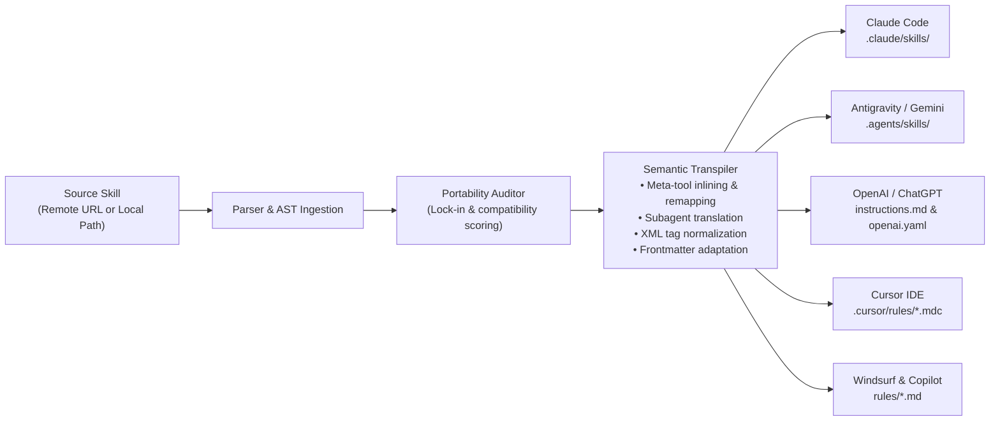

# ⚡ Skill Port (`skill-port`)

> **Universal Cross-LLM Agent Skill Porter & Transpiler.**  
> *Write once, run on any AI agent — Claude Code, ChatGPT / OpenAI, Google Antigravity / Gemini CLI, Cursor, Windsurf, GitHub Copilot.*

---

## 🚀 Overview

The AI developer ecosystem is rapidly adopting **Agent Skills** (markdown-based workflows, procedural runbooks, and domain guidelines). However, skills have become fragmented across incompatible agent platforms:

- **Claude Code** uses `.claude/skills/`, proprietary `Skill(name=...)` meta-tool delegation, and `disable-model-invocation` flags.
- **Google Antigravity / Gemini CLI** uses `.agents/skills/`, progressive disclosure, `invoke_subagent`, and hierarchical rules.
- **OpenAI / ChatGPT** requires Custom GPT instructions, `agents/openai.yaml` manifests, and OpenAI function calling JSON schemas.
- **Cursor** uses `.cursor/rules/*.mdc` with glob filters and metadata.
- **Windsurf & GitHub Copilot** use dedicated workspace rule files.

**`skill-port`** bridges this divide. It allows developers and AI agents to seamlessly install, transpile, and adapt skills across any LLM platform with zero friction.

---

## 🔒 Privacy, Security & Data Handling

Privacy and execution security are core design principles of `skill-port`:

- **100% Local Execution**: All file parsing, AST transformation, semantic rewriting, and file writing take place strictly on your local machine.
- **Zero Telemetry**: `skill-port` contains **zero tracking, telemetry, or analytics**. No data or metadata about your skills, files, or agent sessions is collected or sent anywhere.
- **No Third-Party Cloud Dependencies**: Transpilation uses pure local JavaScript logic with **zero external runtime dependencies**—no external LLM API calls are required to transpile or adapt skills.
- **Network Safety**: Network access is only utilized when you explicitly tell `skill-port` to download a skill from a remote URL (such as a GitHub repository). Remote scripts are never executed automatically without user initiation.
- **Secrets Protection**: `skill-port` never reads, stores, or transmits environment variables, credentials, or private workspace memory files (such as local `.env` or memory files).

---

## 📦 Installation Guide

### Option 1: Instant Run with `npx` (No Install Required)
You can run `skill-port` directly without installing:

```bash
# Detect current agent environment
npx skill-port detect

# Port and install an external skill directly into your current workspace:
npx skill-port install https://github.com/<owner>/<repo>/tree/main/skills/<skill-name>
```

### Option 2: Global CLI Installation
Install globally to use `skill-port`, `skillport`, or `agent-port` everywhere:

```bash
npm install -g skill-port
```

### Option 3: Install as an Autonomous Skill Inside Any AI Agent
Because this repository is itself packaged as a universal agent skill, you can mount it into your agent so the agent handles porting automatically:

* **Google Antigravity / Gemini CLI**:
  Copy [`skills/skill-port/SKILL.md`](./skills/skill-port/SKILL.md) to `.agents/skills/skill-port/SKILL.md` (or globally to `~/.gemini/config/skills/skill-port/SKILL.md`).
* **Claude Code**:
  Copy [`skills/skill-port/SKILL.md`](./skills/skill-port/SKILL.md) to `.claude/skills/skill-port/SKILL.md`.
* **Cursor**:
  Copy [`.cursor/rules/skill-port.mdc`](./.cursor/rules/skill-port.mdc) to your project's `.cursor/rules/`.

Once installed, simply instruct your agent in plain English:
> *"Port and install the skill from `https://github.com/<owner>/<repo>/tree/main/skills/<skill-name>` for this workspace."*

---

## 🔄 Architecture & Transpilation Flow



---

## 🧩 Compatibility Matrix

| Target Platform | Output Directory / Files | Semantic Adaptations |
| :--- | :--- | :--- |
| **Google Antigravity / Gemini** | `.agents/skills/<name>/SKILL.md`<br/>`~/.gemini/config/skills/` | Progressive disclosure frontmatter, `invoke_subagent` mapping, inlines or links meta-skill calls. |
| **Claude Code** | `.claude/skills/<name>/SKILL.md` | Claude Code frontmatter, `disable-model-invocation`, `SubAgent` mapping. |
| **OpenAI / ChatGPT** | `openai/skills/<name>/instructions.md`<br/>`agents/openai.yaml`<br/>`tool_schema.json` | Generates Custom GPT prompt, YAML agent manifest, and OpenAI function calling tool schema. |
| **Cursor IDE** | `.cursor/rules/<name>.mdc` | Cursor rule frontmatter (`description`, `globs: *`, `alwaysApply: false`). |
| **Windsurf** | `.windsurf/rules/<name>.md` | Cascade rule definition with trigger context. |
| **GitHub Copilot** | `.github/skills/<name>.md` | Copilot custom instructions reference. |
| **Universal** | `skills/<name>/SKILL.md` | Platform-neutral specification adhering to open agent skills standards. |

---

## 🛠️ CLI Command Reference

### `install`
Installs and transpiles a skill directly into the active AI agent environment (or a specified target).

```bash
npx skill-port install <url|path> [options]

# Options:
#   --to <agent>    Target agent: antigravity, claude, openai, cursor, etc. (Defaults to auto-detected agent)
#   --global        Install to user global config (e.g. ~/.gemini/config/skills)
#   --dest <path>   Custom output directory
#   --force, -y     Overwrite existing files without prompting
#   --no-inline     Preserve external skill references instead of inlining
#   --dry-run       Preview transpiled files without writing to disk
```

### `port`
Transpiles a skill without modifying current workspace configuration.

```bash
npx skill-port port <url|path> --to <agent> --dest <output-folder>
```

### `audit`
Scans a skill for proprietary vendor lock-in (e.g., proprietary meta-tools, XML tags, or environment-specific dependencies) and outputs a portability score:

```bash
npx skill-port audit ./skills/code-reviewer
```

Output:
```text
🔎 Auditing portability for: ./skills/code-reviewer...

📊 Portability Score: 85/100

🎯 Target Compatibility:
   • claude      : ✓ Compatible
   • antigravity : ✓ Compatible
   • openai      : ✓ Compatible
   • cursor      : ✓ Compatible

✓ Skill is portable across supported AI agents!
```

### `detect`
Detects the active agent environment in the current workspace:

```bash
npx skill-port detect
```

### `list`
Lists all installed skills across all agent directories in the workspace:

```bash
npx skill-port list
```

---

## 💻 Programmatic API (Node.js & TypeScript)

You can import `skill-port` as an ES Module in your TypeScript or JavaScript projects:

```typescript
import { portSkill, installSkill, auditSkill } from 'skill-port';

// 1. Audit a skill
const audit = await auditSkill('./skills/code-reviewer');
console.log(`Portability Score: ${audit.score}/100`);

// 2. Transpile for ChatGPT / OpenAI Custom GPT
const transpiled = await portSkill('./skills/code-reviewer', {
  to: 'openai',
});

for (const file of transpiled.files) {
  console.log(`Generated: ${file.relativePath}`);
}

// 3. Auto-install for detected environment
await installSkill('./skills/code-reviewer');
```

---

## 🧪 Running Tests

The test suite runs with Node's native test runner (zero external test dependencies required):

```bash
npm test
```

---

## 📄 License

MIT © [Skill Port Contributors](./LICENSE)
